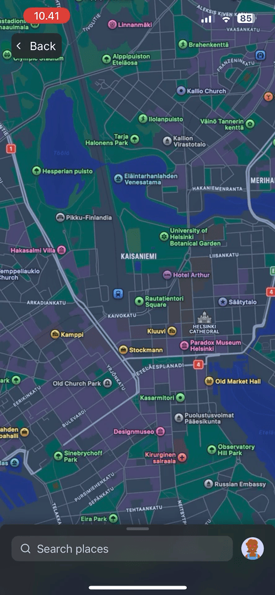
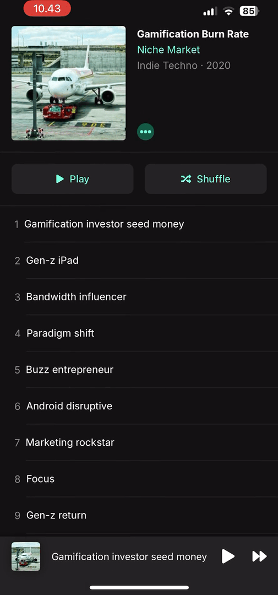
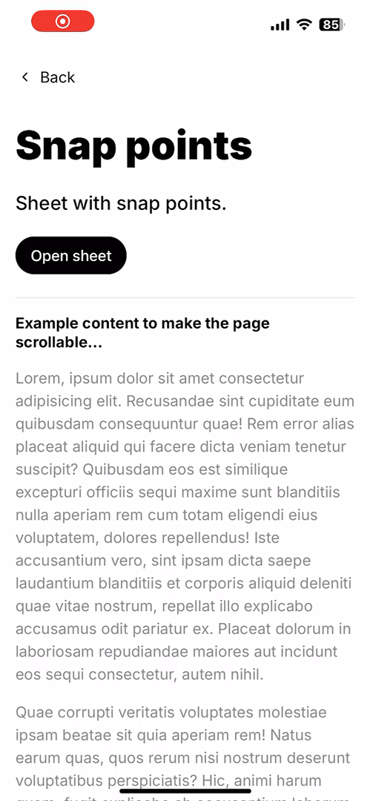
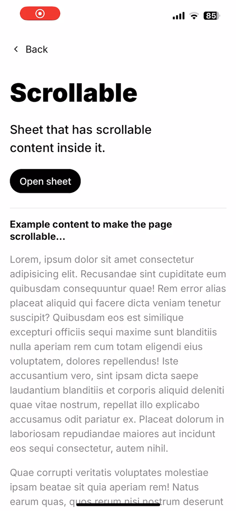

<p align='center'>
  
<p/>

<div align="center" >
  &middot;
  <i>Flexible bottom sheet component for your React apps</i>
  &middot;
  <br/>
  <br/>
  
  
  
  <br/>
  <br/>
</div>

|  |  |  |  |
| :-------------------------------: | :--------------------------------: | :--------------------------------: | :-------------------------------: |

## Documentation

Visit the [documentation website](https://temzasse.github.io/react-modal-sheet/) for installation, usage, API reference, guides, and interactive examples.

- [Get started](https://temzasse.github.io/react-modal-sheet/getting-started/installation/)
- [Explore the examples](https://temzasse.github.io/react-modal-sheet/examples/)
- [Contribute](https://temzasse.github.io/react-modal-sheet/contributing/)

## Local documentation

```sh
npm ci --prefix docs
npm run dev
```

Open http://localhost:4321/react-modal-sheet/. See [the docs guide](docs/README.md) for build and GitHub Pages setup.
